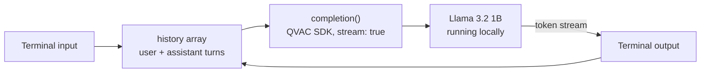

# QVAC On-Device Chat

A minimal terminal chatbot that runs a language model **entirely on your machine** with Tether's [QVAC SDK](https://www.npmjs.com/package/@qvac/sdk). No API key, no server, and no message leaves the device.


-8a2be2)
[](LICENSE)

## What it does

- Loads **Llama 3.2 1B Instruct** (4-bit quantized) through QVAC. The model is downloaded once on the first run, with a progress indicator, and reused afterwards.
- Runs a chat loop in the terminal and **streams the reply token by token**.
- Keeps the full conversation history in memory, so follow-up questions have context.
- Unloads the model cleanly when you type `exit`.

The whole app is one file, [`app.js`](app.js), about 40 lines.

## Quickstart

Needs Node.js 18 or newer.

```bash
git clone https://github.com/Nakulraj-23/qvac-onchat.git
cd qvac-onchat
npm install
QVAC_CONFIG_PATH=./qvac.config.json npm start
```

On Windows PowerShell, set the variable first:

```powershell
$env:QVAC_CONFIG_PATH = "./qvac.config.json"; npm start
```

Example session:

```text
Loading model on-device (first run downloads it)...
Model loaded. Type a message (or "exit" to quit).

You: What is a quantized model?
AI: A quantized model stores its weights with fewer bits ...

You: exit
Model unloaded. Bye!
```

## How it works



| Step | Code | What happens |
|---|---|---|
| Load | `loadModel({ modelSrc, onProgress })` | Downloads the model on first run and loads it into memory |
| Chat | `completion({ modelId, history, stream: true })` | Sends the whole conversation and returns an async token stream |
| Exit | `unloadModel({ modelId })` | Frees the model before the process ends |

[`qvac.config.json`](qvac.config.json) sets the SDK's log level and download settings (3 parallel connections, 10 s connection timeout).

## Limitations

- The conversation is kept only in memory and is lost when you exit.
- History grows without trimming, so a very long chat will eventually exceed the model's context window.
- A 1B-parameter model is fast and small but makes more mistakes than larger models.

## License

MIT, see [LICENSE](LICENSE). The QVAC SDK is Apache-2.0, and the Llama 3.2 weights are under Meta's Llama 3.2 Community License.
